# Documentación de la Aplicación — APP EntidadIES

> **Fecha**: 29 de junio de 2026  
> **Versión**: 1.0.0  
> **Stack**: Next.js 16 + React 19 + TypeScript + Tailwind CSS v4 + FastAPI + SQLite

---

## Índice

1. [Descripción General](#1-descripción-general)
2. [Arquitectura](#2-arquitectura)
3. [Mapa de Rutas y Páginas](#3-mapa-de-rutas-y-páginas)
4. [Detalle de Cada Página](#4-detalle-de-cada-página)
5. [Componentes Comunes](#5-componentes-comunes)
6. [API Backend](#6-api-backend)
7. [Navegación](#7-navegación)

---

## 1. Descripción General

**APP EntidadIES** es una aplicación web de gestión para instituciones educativas de Formación Profesional en Aragón. Proporciona herramientas para:

- **Gestión documental** del centro (PEC, RRI, PGA, etc.)
- **Sistema de Gestión de Calidad (SGC)** completo: DAFO, procesos, riesgos, auditorías, indicadores
- **Programas institucionales** (PROA+, Ajedrez, Erasmus+, APE, Xcelence)
- **Calendario académico** con diagrama de Gantt
- **Sincronización con Google Drive** para archivos del centro

La aplicación está diseñada como una **herramienta operativa y de gestión** que NO almacena datos reales del docente en el servidor — solo gestiona catálogos oficiales y datos DEMO para pruebas.

---

## 2. Arquitectura

```
APP-EntidadIES/
├── frontend/          # Next.js 16 + React 19 + TypeScript
│   ├── src/
│   │   ├── app/       # App Router (rutas = páginas)
│   │   ├── components/
│   │   │   ├── layout/    # PageLayout, Header, Sidebar
│   │   │   ├── ui/        # Card, Tabs, Button, Modal...
│   │   │   ├── common/    # DriveFileViewer, Spinner...
│   │   │   └── features/  # qms/, xcelence/, ape/
│   │   ├── config/        # navigation.ts
│   │   ├── store/         # Zustand (useAppStore)
│   │   └── lib/           # api.ts, utils
│   └── public/
├── backend/           # Python FastAPI + SQLite
│   ├── main.py        # Punto de entrada FastAPI
│   ├── models.py      # Modelos SQLAlchemy
│   ├── schemas.py     # Pydantic schemas
│   ├── routers/       # Endpoints API REST
│   └── services/      # Lógica de negocio
└── docs/
    └── screenshots/   # Capturas de cada página
```

### Stack tecnológico

| Capa | Tecnología |
|------|-----------|
| Frontend | Next.js 16.2.7, React 19, TypeScript |
| Estilos | Tailwind CSS v4, CSS variables |
| Estado | Zustand (useAppStore) |
| Backend | Python 3.13, FastAPI |
| Base de datos | SQLite (cdd_pro.db) |
| Despliegue | Firebase Hosting + Cloud Run |

---

## 3. Mapa de Rutas y Páginas

La aplicación tiene **15 rutas** organizadas en **4 grupos** de navegación:

### Grupo 1: General (sin título)
| Ruta | Página | Icono | Descripción |
|------|--------|-------|-------------|
| `/archivos` | Archivos | FolderOpen | Sincronización en la nube y configuración del espacio de trabajo |
| `/calendario` | Calendario | Calendar | Diagrama de Gantt de actividades |
| `/documentos` | Documentos | FolderOpen | Explorador de archivos oficiales, legislación y otros documentos |
| `/ayuda` | Ayuda | Activity | Panel de ayuda |

### Grupo 2: Centro
| Ruta | Página | Icono | Descripción |
|------|--------|-------|-------------|
| `/dafo` | Matriz DAFO | Target | Análisis interno y externo |
| `/objetivos` | Objetivos Estratégicos | Activity | Objetivos de dirección |
| `/documental` | Documental | BookOpen | Documentos oficiales del centro (PEC, RRI, PGA, etc.) |
| `/direccion` | Proyecto de Dirección | FileText | Análisis comparativo de proyectos de dirección |

### Grupo 3: Gestión
| Ruta | Página | Icono | Descripción |
|------|--------|-------|-------------|
| `/procesos` | Mapa de Procesos (SGC) | GitBranch | Procesos Estratégicos, Clave y de Apoyo |
| `/riesgos` | Riesgos y Oportunidades | AlertTriangle | Matriz de riesgos y contexto |
| `/auditorias` | Auditorías (SGC) | ClipboardList | Internas, externas y No Conformidades |
| `/indicadores` | Indicadores de Calidad | BarChart | Métricas de los procesos |

### Grupo 4: Programas
| Ruta | Página | Icono | Descripción |
|------|--------|-------|-------------|
| `/programas` | Gestión de Programas | Layers | Ajedrez, Proa+, Erasmus... |
| `/xcelence` | Xcelence | Shield | Claves de Orientación |
| `/ape` | Aula de Emprendimiento | Briefcase | Aula Profesional de Emprendimiento |

> **Nota**: La ruta raíz `/` redirige automáticamente a `/inicio`.

---

## 4. Detalle de Cada Página

### 4.1 Inicio (`/inicio`)

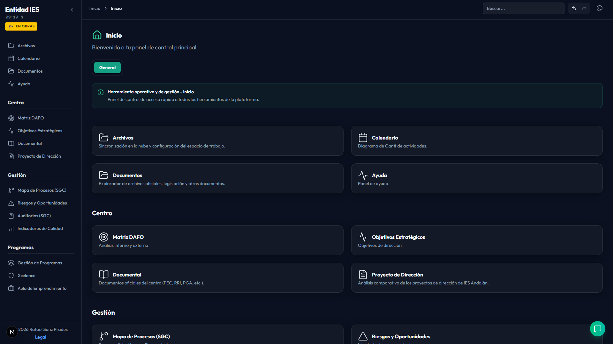

**Función**: Panel de control principal con acceso rápido a todas las herramientas.

- Muestra los 4 grupos de navegación como tarjetas clicables
- Cada tarjeta muestra icono, nombre y descripción
- Animaciones de entrada escalonadas (MotionWrapper)
- Layout: grid responsive (1 columna en móvil, 2 en desktop)

---

### 4.2 Archivos (`/archivos`)

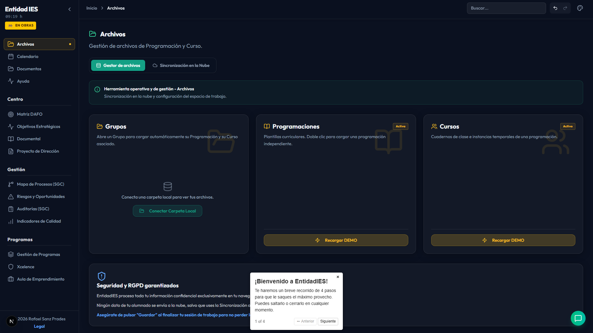

**Función**: Gestión de archivos del centro con sincronización a Google Drive.

- Explorador de archivos con vista de lista
- Botones de acción: Nuevo, Abrir, Guardar, Guardar como, Descargar
- Integración con Google Drive para sincronización
- Breadcrumb: "Inicio → Archivos"

---

### 4.3 Documental (`/documental`)

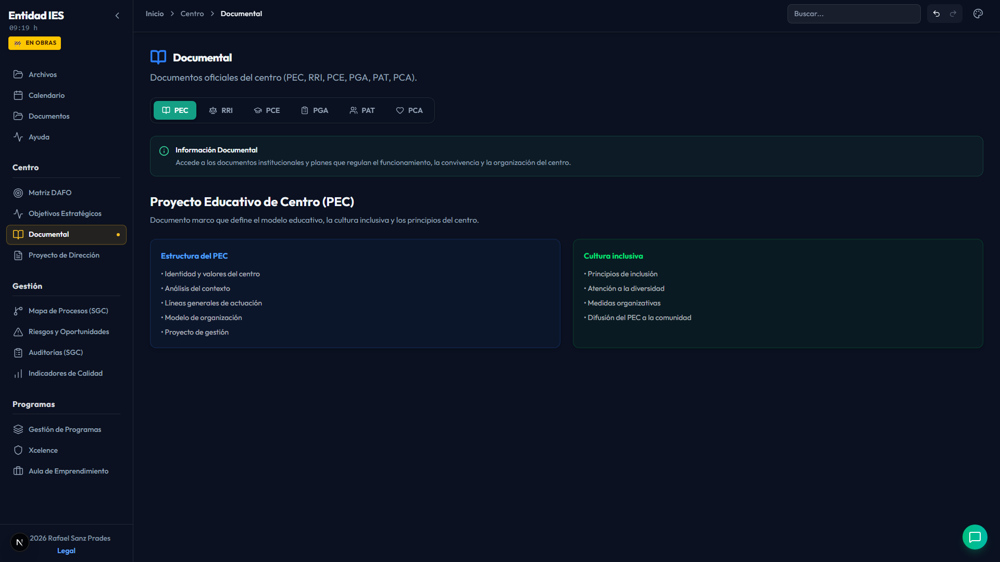

**Función**: Repositorio de documentos oficiales del centro.

- Documentos institucionales: PEC, RRI, PGA, Plan de Convivencia, etc.
- Organización por categorías
- Vista de lista con metadatos
- Breadcrumb: "Inicio → Documental"

---

### 4.4 Calendario (`/calendario`)

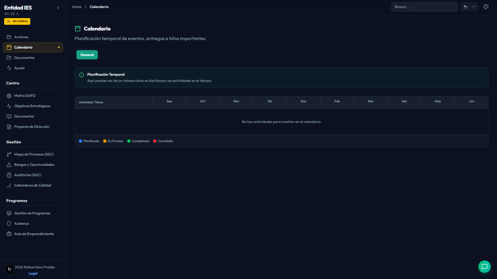

**Función**: Diagrama de Gantt interactivo del curso académico.

- Timeline visual de actividades del curso
- Eventos académicos: inicio/fin de trimestres, evaluaciones, festivos
- Navegación por meses
- Breadcrumb: "Inicio → Calendario"

---

### 4.5 Documentos (`/documentos`)

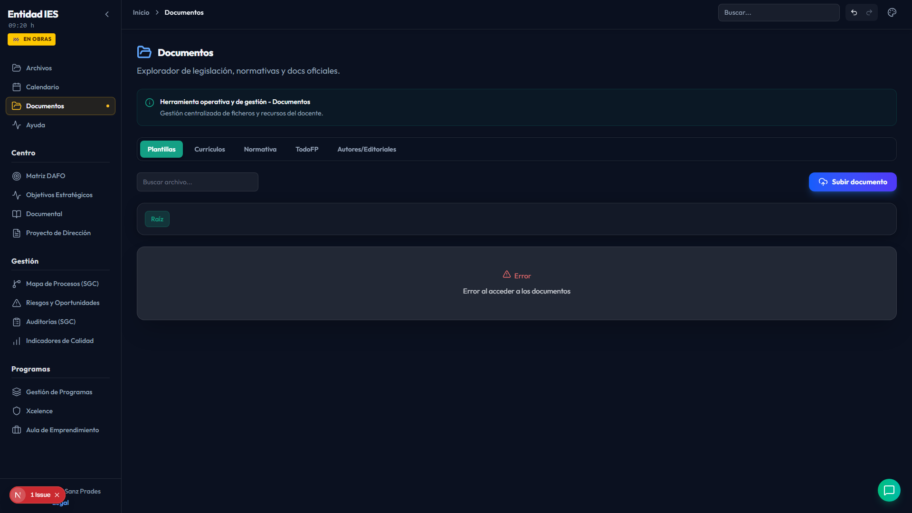

**Función**: Explorador de archivos oficiales, legislación y otros documentos.

- Categorías: Legislación, Normativa, Documentos oficiales
- Búsqueda y filtrado
- Breadcrumb: "Inicio → Documentos"

---

### 4.6 Ayuda (`/ayuda`)

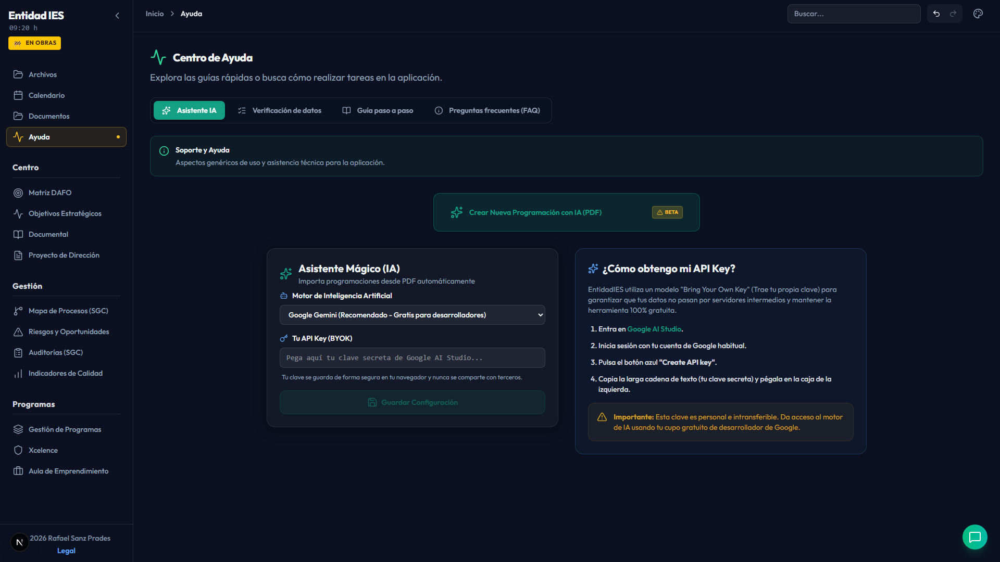

**Función**: Centro de ayuda y soporte de la aplicación.

- Preguntas frecuentes
- Guía de uso por secciones
- Información de contacto y soporte
- Breadcrumb: "Inicio → Ayuda"

---

### 4.7 Centro (agrupación)

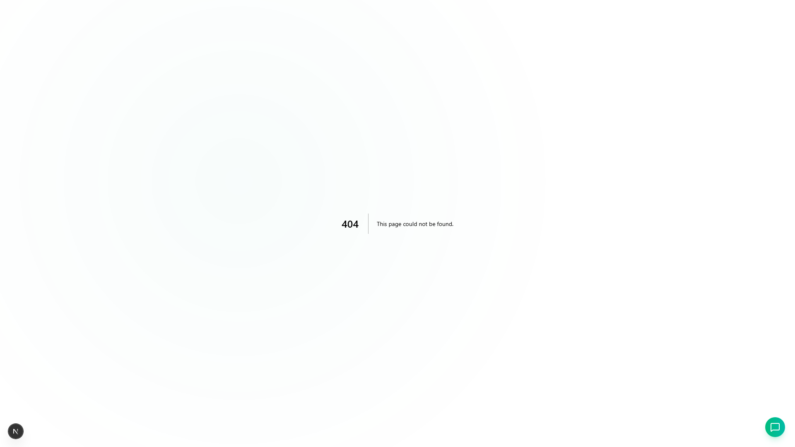

**Función**: Vista de grupo del menú "Centro" en la página de inicio.

---

### 4.8 Matriz DAFO (`/dafo`)

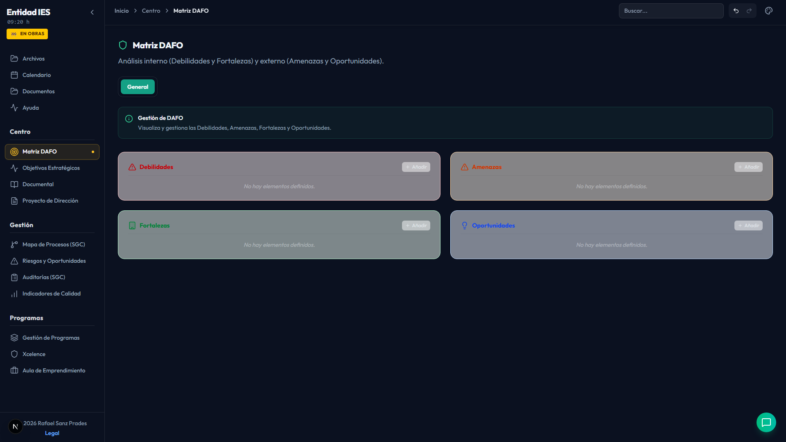

**Función**: Análisis DAFO (Debilidades, Amenazas, Fortalezas, Oportunidades) del centro.

- **Layout**: Cuadrante 2×2 con 4 categorías
- **API**: `GET/POST/DELETE /api/qms/dafo`
- **Categorías**: Debilidades (rojo), Amenazas (naranja), Fortalezas (verde), Oportunidades (azul)
- **CRUD completo**: Añadir, editar, eliminar ítems por categoría
- **Componente**: `DafoModal` para creación/edición
- Breadcrumb: "Inicio → Matriz DAFO"

---

### 4.9 Objetivos Estratégicos (`/objetivos`)

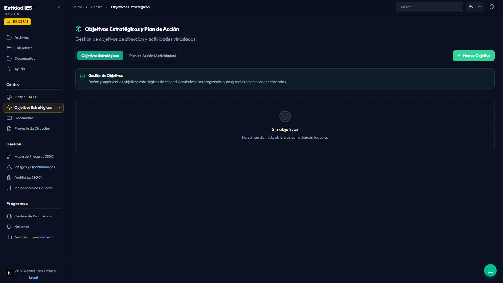

**Función**: Gestión de objetivos estratégicos del centro con sus actividades.

- **Tabs**: Objetivos | Programas | Actividades | Actores
- **APIs**: `/api/qms/objectives`, `/api/qms/programs`, `/api/qms/activities`, `/api/qms/actors`
- **CRUD completo** para cada entidad
- **Componentes**: `ObjectiveModal`, `ActivityModal`
- Relación: Objetivos → Programas → Actividades → Actores
- Breadcrumb: "Inicio → Objetivos Estratégicos"

---

### 4.10 Proyecto de Dirección (`/direccion`)

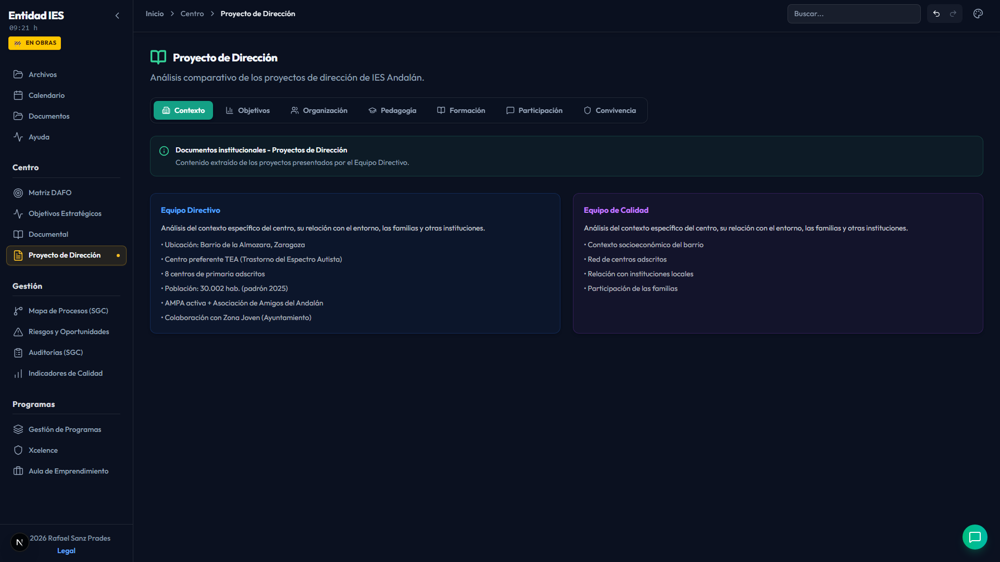

**Función**: Análisis comparativo de los proyectos de dirección del IES Andalán.

- **7 tabs**: Contexto | Objetivos | Organización | Pedagogía | Formación | Participación | Convivencia
- **Contenido estático** (hardcoded en el componente)
- **Datos del centro**: Barrio de la Almozara, Zaragoza — Centro preferente TEA
- **Layout**: Grid de tarjetas informativas por cada tab
- Breadcrumb: "Inicio → Proyecto de Dirección"

---

### 4.11 Mapa de Procesos del SGC (`/procesos`)

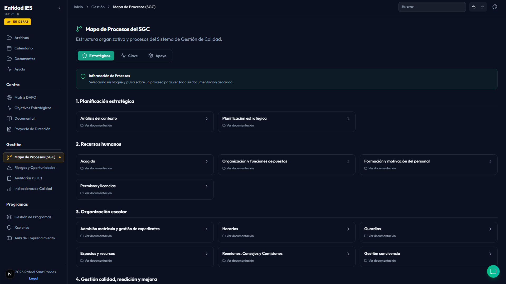

**Función**: Estructura organizativa del Sistema de Gestión de Calidad.

- **3 categorías** (tabs): Estratégicos | Clave | Apoyo
- **API**: `GET /api/qms/procesos`
- Cada proceso se muestra como tarjeta expandible
- Iconos diferenciados por tipo: Shield (Estratégicos), Activity (Clave), Settings (Apoyo)
- Integración con `DriveFileViewer` para documentos asociados
- Breadcrumb: "Inicio → Mapa de Procesos (SGC)"

---

### 4.12 Matriz de Riesgos y Oportunidades (`/riesgos`)

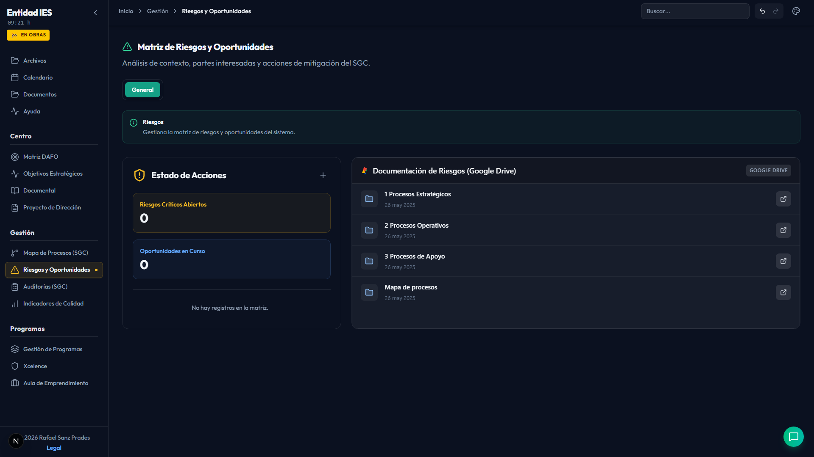

**Función**: Análisis de contexto, partes interesadas y acciones de mitigación.

- **Layout**: Panel lateral izquierdo (resumen) + contenido principal
- **API**: `GET /api/qms/riesgos`
- **Métricas**: Riesgos Críticos Abiertos, Oportunidades en Curso
- **Tipos**: Riesgo (con nivel de riesgo ≥ 15 = crítico) y Oportunidad
- Integración con `DriveFileViewer`
- Breadcrumb: "Inicio → Riesgos"

---

### 4.13 Auditorías y No Conformidades (`/auditorias`)

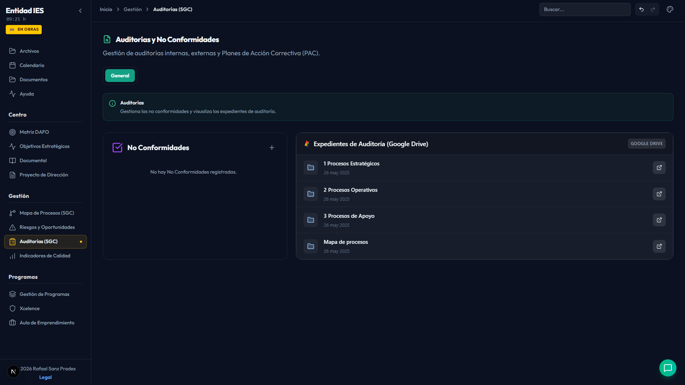

**Función**: Gestión de auditorías internas/externas y Planes de Acción Correctiva (PAC).

- **Layout**: Panel lateral (lista de NC) + contenido principal
- **API**: `GET /api/qms/no-conformidades`
- **Estados**: Abierta (rojo), En curso (amarillo), Cerrada (verde)
- **CRUD**: Crear, editar, eliminar no conformidades
- Integración con `DriveFileViewer`
- Breadcrumb: "Inicio → Auditorías SGC"

---

### 4.14 Indicadores de Calidad (`/indicadores`)

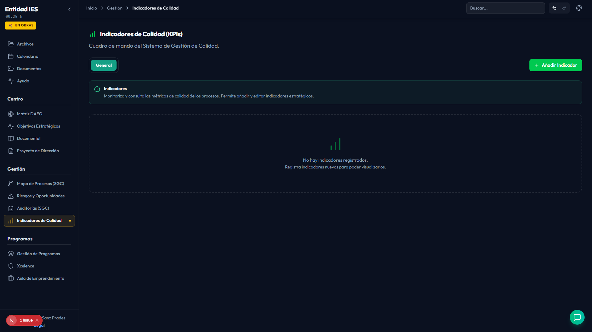

**Función**: Métricas y KPIs de los procesos del SGC.

- **APIs**: `/api/qms/indicators`, `/api/qms/procesos`, `/api/qms/objectives`
- **CRUD completo** con `IndicatorModal`
- Cada indicador vinculado a un proceso y/o objetivo
- Visualización con gráficos/barras de progreso
- Breadcrumb: "Inicio → Indicadores de Calidad"

---

### 4.15 Gestión de Programas (`/programas`)

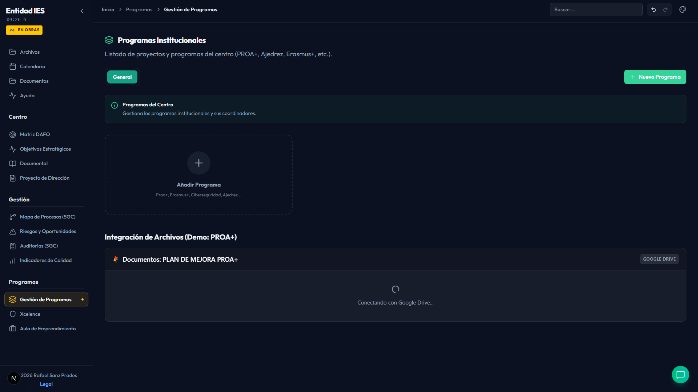

**Función**: Listado de proyectos y programas institucionales del centro.

- **APIs**: `/api/qms/programs`, `/api/qms/actors`
- **Programas ejemplo**: PROA+, Ajedrez, Erasmus+, etc.
- **CRUD completo** con `ProgramModal`
- Cada programa tiene coordinador (actor) asociado
- Integración con `DriveFileViewer`
- Breadcrumb: "Inicio → Programas"

---

### 4.16 Xcelence (`/xcelence`)

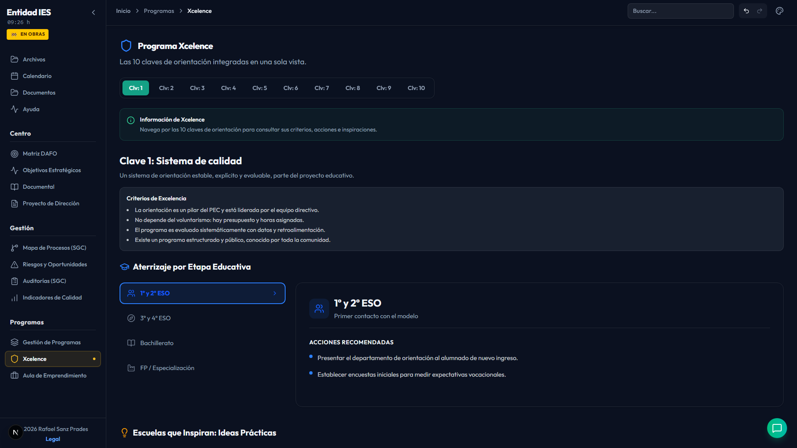

**Función**: Marco de las 10 Claves de Orientación del modelo Xcelence.

- **Contenido estático** (hardcoded: `xcelenceData`)
- **10 Claves** de orientación educativa, cada una con:
  - Descripción y lista de información clave
  - **4 etapas**: 1º-2º ESO, 3º-4º ESO, Bachillerato, FP/Especialización
  - Acciones específicas por etapa
  - Inspiraciones (ideas innovadoras)
- **Componente**: `ClaveExcellenceView`
- **Tabs**: Una por cada clave
- Breadcrumb: "Inicio → Xcelence"

---

### 4.17 Aula Profesional de Emprendimiento (`/ape`)

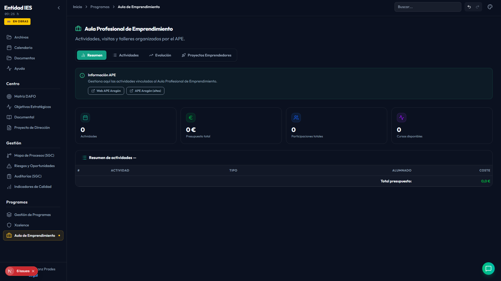

**Función**: Actividades, visitas y talleres del Aula Profesional de Emprendimiento.

- **4 tabs**: Resumen | Actividades | Evolución | Proyectos Emprendedores
- **Componente**: `ApeView` (recibe `currentView`)
- **Enlaces externos**: Web APE Aragón, APE Aragón (sites)
- **Proyectos Emprendedores**: En desarrollo (placeholder)
- Breadcrumb: "Inicio → APE"

---

## 5. Componentes Comunes

### PageLayout
Componente de layout estándar para todas las páginas. Props:
- `icon`: Icono de la página
- `title`: Título principal
- `description`: Subtítulo descriptivo
- `tabs`: Array de tabs (opcional)
- `activeTab` / `onTabChange`: Control de tabs
- `infoTitle` / `infoDescription`: Contenido del panel de información
- `breadcrumbSuffix`: Sufijo para el breadcrumb del header
- `rightAction`: Botón de acción principal (opcional)

### Header (Breadcrumb)
Muestra breadcrumb universal: **Inicio → Página → Tab activa**.

### Tabs
Componente reutilizable de pestañas con soporte para iconos.

### DriveFileViewer
Visor de archivos de Google Drive integrado en varias páginas del SGC.

### Modales (CRUD)
- `DafoModal` — Crear/editar ítems DAFO
- `ObjectiveModal` — Crear/editar objetivos estratégicos
- `ActivityModal` — Crear/editar actividades
- `IndicatorModal` — Crear/editar indicadores de calidad
- `ProgramModal` — Crear/editar programas institucionales

---

## 6. API Backend

### Endpoints principales

| Método | Ruta | Descripción |
|--------|------|-------------|
| GET | `/api/qms/dafo` | Listar ítems DAFO |
| POST | `/api/qms/dafo` | Crear ítem DAFO |
| DELETE | `/api/qms/dafo/{id}` | Eliminar ítem DAFO |
| GET | `/api/qms/objectives` | Listar objetivos |
| POST | `/api/qms/objectives` | Crear objetivo |
| DELETE | `/api/qms/objectives/{id}` | Eliminar objetivo |
| GET | `/api/qms/programs` | Listar programas |
| POST | `/api/qms/programs` | Crear programa |
| DELETE | `/api/qms/programs/{id}` | Eliminar programa |
| GET | `/api/qms/activities` | Listar actividades |
| POST | `/api/qms/activities` | Crear actividad |
| GET | `/api/qms/actors` | Listar actores |
| GET | `/api/qms/procesos` | Listar procesos del SGC |
| GET | `/api/qms/riesgos` | Listar riesgos y oportunidades |
| GET | `/api/qms/no-conformidades` | Listar no conformidades |
| GET | `/api/qms/indicators` | Listar indicadores |
| POST | `/api/qms/indicators` | Crear indicador |
| DELETE | `/api/qms/indicators/{id}` | Eliminar indicador |

### Base de datos
- **SQLite**: `backend/cdd_pro.db`
- **ORM**: SQLAlchemy
- **Migraciones**: Script `init_db.py`

---

## 7. Navegación

### Estructura del menú lateral

```
┌─────────────────────────┐
│  [Archivos]             │
│  [Calendario]           │
│  [Documentos]           │
│  [Ayuda]                │
├─────────────────────────┤
│  Centro                 │
│  ├─ Matriz DAFO         │
│  ├─ Objetivos Estratég. │
│  ├─ Documental          │
│  └─ Proyecto Dirección  │
├─────────────────────────┤
│  Gestión                │
│  ├─ Mapa Procesos (SGC) │
│  ├─ Riesgos/Oportunid.  │
│  ├─ Auditorías (SGC)    │
│  └─ Indicadores Calidad │
├─────────────────────────┤
│  Programas              │
│  ├─ Gestión Programas   │
│  ├─ Xcelence            │
│  └─ Aula Emprendimiento │
└─────────────────────────┘
```

### Breadcrumb
Todas las páginas muestran breadcrumb en el header:  
**Inicio → [Nombre de la página] → [Tab activa]** (si aplica)

---

## Capturas de Pantalla

Todas las capturas están en `docs/screenshots/`:

| Archivo | Página |
|---------|--------|
| `01-inicio.png` | Inicio |
| `02-archivos.png` | Archivos |
| `03-documental.png` | Documental |
| `04-calendario.png` | Calendario |
| `05-documentos.png` | Documentos |
| `06-ayuda.png` | Ayuda |
| `07-centro.png` | Centro (agrupación) |
| `08-dafo.png` | Matriz DAFO |
| `09-objetivos.png` | Objetivos Estratégicos |
| `10-direccion.png` | Proyecto de Dirección |
| `11-procesos.png` | Mapa de Procesos |
| `12-riesgos.png` | Riesgos y Oportunidades |
| `13-auditorias.png` | Auditorías |
| `14-indicadores.png` | Indicadores de Calidad |
| `15-programas.png` | Gestión de Programas |
| `16-xcelence.png` | Xcelence |
| `17-ape.png` | APE |
